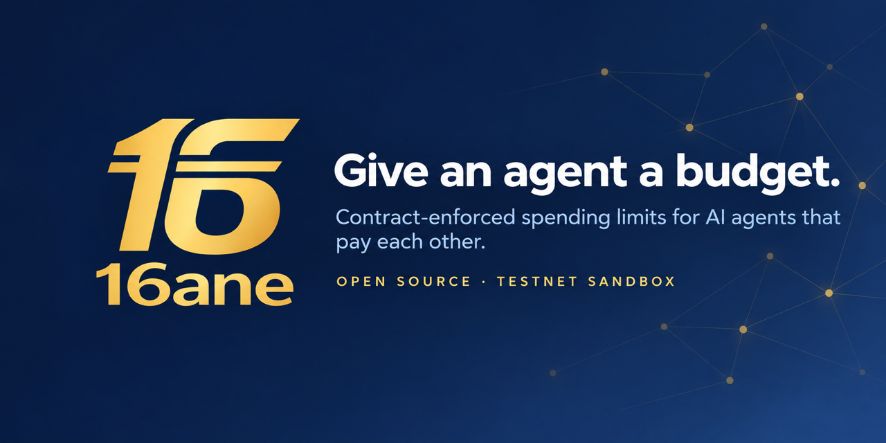

<p align="center">
  
</p>

# 16ane — Open Agent Economy

**Status:** Product vision, planning specification, and a sandbox implementation (contracts, SDKs, CLI, reference server) that is tested locally and in CI only, v0.1.0 (2026-10-19). **Nothing is deployed to a public network, no hosted faucet or API exists, and this is not a regulatory authorization.** See [launch readiness](docs/planning/LAUNCH_READINESS.md).

> **16 Aane = 1 Rupee.** Give an agent a budget. Let it discover, spend, earn, and return value.

## Executive vision
16ane.com aims to provide an open, crypto-native machine-to-machine economy. People or organizations fund isolated wallets for AI agents. Agents independently buy intelligence, APIs, compute, data and services; offer and sell services to other agents; receive proceeds; optionally recycle earned funds within owner-defined authority; and return unspent funds. Financial constraints must be enforced by contracts/signatures, never by LLM instructions.

**Launch strategy:** a **permanent, worldwide public sandbox** using freely issued **tANE** on an EVM testnet, plus SDKs, faucet, paid demo endpoints, discovery and provider-sponsored introductory credits. The sandbox has **zero monetary value**, no INR reserves, no redemption rights and no conversion promise. Maintain a separate breaking-change dev environment. Real-money **ANE** is a future, separately gated INR-reserve-backed proposal requiring legal/regulatory review and an appropriate licensed institutional arrangement. No live INR deposits or mainnet minting are authorized by this document.

**Unit convention:** Historical 16 annas = ₹1. Proposed target **16 ANE = ₹1**, hence **1 ANE = ₹0.0625**; 1,600 ANE represents ₹100 at target. Testnet tANE uses the same *illustrative* unit scale but **is not worth ₹100** when a faucet gives 1,600 tANE. Token denomination and decimals are ADR decisions.

## Why separate from COPRA?
COPRA is commodity-referenced and therefore has variable INR purchasing power. 16ane targets predictable INR-referenced pricing for agents. Reuse open wallet/payment infrastructure where possible; do not merge monetary policies or imply COPRA backing.

## Guiding principles
- Permissionless testnet token transfers and open integrations; hosted faucet/inference may enforce anti-abuse quotas.
- Owner controls funding, authority, revocation and withdrawals; agents choose transactions within the permitted envelope.
- No mandatory 16ane-operated facilitator, hosted registry, or marketplace for peer-to-peer settlement.
- Prefer existing standards, open specifications, portable identity and reproducible contracts.
- Separate transferable **tANE**, provider-specific service entitlements, and any future reserve-backed **ANE**.
- Publish honest cost, reserve, settlement and centralization assumptions; avoid claims of guaranteed value or universal frictionlessness.
- Support India-first content and examples while allowing global sandbox participation.

## First five-minute success story
_Target experience once the public sandbox is deployed; none of the hosted pieces below exist yet._

1. Developer opens `docs.16ane.com` and creates an agent wallet on the public sandbox.
2. Faucet grants 16,000 **tANE** (not rupees); owner delegates a fixed budget.
3. Agent discovers a paid demo API and pays 16 tANE via a supported payment adapter.
4. Agent publishes its own endpoint, receives tANE from another agent, and sees its revenue.
5. Owner revokes authority and recovers the remaining funds; a receipt is independently verifiable.

## Setup

Prerequisites: [Foundry](https://book.getfoundry.sh/getting-started/installation), Node.js 24+ (runs TypeScript via `--experimental-strip-types`), Python 3.11+. The SDKs have no third-party runtime dependencies; `npm ci` only installs the TypeScript type-checker.

```bash
git clone --recurse-submodules https://github.com/bytesbrains/16ane.git
cd 16ane
scripts/setup_hooks.sh   # optional: gitleaks + forge fmt pre-commit; gitleaks + tests pre-push
npm ci                   # dev-only: TypeScript type-checker (the SDKs have no runtime deps)

make build               # forge build --sizes
make test                # contracts, TS SDK, Python SDK, CLI, server, E2E scenarios S1-S6
make typecheck           # tsc --strict over SDK, CLI tests, server and E2E
make fmt-check           # forge fmt --check
make deploy-dry-run      # simulate the sandbox deployment (no broadcast)
```

Individual suites: `make test-contracts`, `make test-sdk-ts`, `make test-sdk-py`, `make test-cli`, `make test-server`, `make test-e2e`. `make lint-py` needs `ruff` on your PATH. Everything runs against local Anvil / testnet configuration only; see [CONTRIBUTING.md](CONTRIBUTING.md).

## Documents
- [Agent instructions](AGENTS.md)
- [Product vision and personas](docs/product/VISION.md)
- [Requirements and acceptance](docs/product/REQUIREMENTS.md)
- [Sandbox and free credits](docs/product/SANDBOX_AND_CREDITS.md)
- [Economics and denomination](docs/product/TOKENOMICS.md)
- [Architecture](docs/architecture/SYSTEM.md)
- [Wallet](docs/protocol/WALLET.md)
- [Payments](docs/protocol/PAYMENTS.md)
- [Discovery and provider contracts](docs/protocol/DISCOVERY.md)
- [SDKs, API and CLI](docs/protocol/DEVELOPER_INTERFACES.md)
- [Threat model](docs/security/THREAT_MODEL.md)
- [Future regulated ANE](docs/research/MAINNET_AND_REGULATORY.md)
- [Standards research and ADRs](docs/research/STANDARDS_AND_ADRS.md)
- [Roadmap](docs/planning/ROADMAP.md)
- [Epics](docs/planning/EPICS.md)
- [Issue-writing guide](docs/planning/ISSUE_GENERATION.md)
- [Runbooks and metrics](docs/operations/OPERATIONS.md)
- [Example scenarios](examples/SCENARIOS.md)

**Names and domains.** `16ane.com` serves the project overview (live since 2026-10-19, `ADR-0015`); every other subdomain is a proposal, not a deployment. The domain's earlier business-marketplace use is covered in `ADR-0014`. The names `16ane`, `ANE` and `tANE` are used without trademark registration (maintainer decision, 2026-10-19, #32). Token symbols are not unique: unrelated tokens already use `ANE`, and anyone can deploy a token with the same symbol. Always identify `tANE` by its chain ID and contract address, never by symbol alone (`ADR-0014`).
