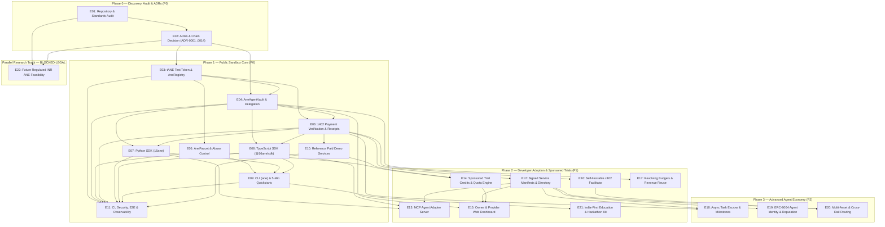

# Epic Dependency Graph and Phase Gates

- **Date:** 2026-10-19
- **Reference:** `docs/planning/ROADMAP.md` and `docs/planning/EPICS.md`

---

## 1. Visual Dependency Graph (Mermaid)

---

## 2. Topological Execution Waves

### Wave 0 — Governance & Architecture Sign-Off (Current Gate)
- **`E01`** Repository & standards audit (`docs/planning/CAPABILITY_GAP_REPORT.md`) — **Complete**
- **`E02`** Architecture Decision Records (`docs/decisions/ADR-0001-*.md` to `ADR-0014-*.md`) — **Drafted; awaiting maintainer review**
- **Gate 0 Exit:** Maintainer sign-off on `ADR-0001`–`ADR-0014` and issue backlog.

### Wave 1 — Foundational Smart Contracts & CI Baseline (P0)
- **`E11-A` (Bootstrap CI/Security):** Port `.gitleaks.toml`, `.githooks`, `foundry.toml` (`solc 0.8.28`), and base GitHub Actions workflow from `copra`.
- **`E03`:** Implement `AneRegistry.sol` and `AneTestToken.sol` (`tANE`, 18 decimals, EIP-2612, EIP-3009, explicit no-value metadata).
- **`E04` (after `E03`):** Implement `AneAgentVault.sol` and `AneVaultFactory.sol` (isolated agent budget, `FIXED` mode cap, EIP-712 `SpendIntent`, owner `revoke`, `withdraw`, `refundPayment`).
- **`E05` (after `E03`):** Implement `AneFaucet.sol` (cooldown, daily cap) + gasless faucet claim service.

### Wave 2 — Payment Protocol, SDKs & Reference Services (P0)
- **`E06` (after `E03`, `E04`):** Implement x402 v2 payment verifier, `ane-vault-v1` and `exact` settlement adapters, idempotency store, and cryptographic receipt generator.
- **`E07` & `E08` (after `E04`, `E06`):** Build Python SDK (`packages/sdk-py`) and TypeScript SDK (`packages/sdk-ts`) in parallel.
- **`E10` (after `E06`, `E08`):** Build deterministic zero-cost reference merchant endpoints (`demo.summarize.v1`, `demo.clean-json.v1`) and sample agent-merchant service.

### Wave 3 — CLI, End-to-End Scenarios & Public Sandbox Launch Gate (P0)
- **`E09` (after `E05`, `E07`, `E08`):** Build `ane` CLI and 5-minute developer quickstart (`README.md` journey).
- **`E11-B` (after `E03`–`E10`):** Complete containerized Anvil E2E suite covering Scenarios `S1`–`S6` (`examples/SCENARIOS.md`), threat model tests `1`–`10` (`docs/security/THREAT_MODEL.md`), SLO telemetry, and Base Sepolia testnet deployment verification.

### Wave 4 — Ecosystem Adoption, MCP, Quotas & Self-Hosting (P1)
- **`E12`:** Signed service manifests (`/.well-known/16ane-service.json` + A2A AgentCard) and `AneServiceDirectory.sol`.
- **`E16`:** Standalone self-hostable x402 facilitator and indexer package.
- **`E14`:** Provider-sponsored trial campaign & real-compute quota engine.
- **`E17`:** Revolving budget mode (`REVOLVING` revenue recycling with ceiling in `AneAgentVault`).
- **`E13`:** MCP server (`@16ane/mcp-server`).
- **`E15`:** Owner & provider web dashboard (`web/`).
- **`E21`:** India-first multilingual tutorials and hackathon starter kit.

### Wave 5 — Advanced Commerce (P2) & Parallel Legal Track (`BLOCKED-LEGAL`)
- **`E18`:** `AneTaskEscrow.sol` for asynchronous milestone jobs.
- **`E19`:** ERC-8004 agent identity and reputation adapter.
- **`E20`:** Multi-asset / cross-rail payment adapter.
- **`E22` (`BLOCKED-LEGAL`):** Independent Indian legal counsel opinion and licensed financial institution feasibility dossier (research only; zero live funds or mainnet code).
